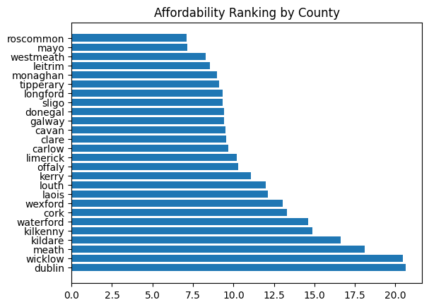
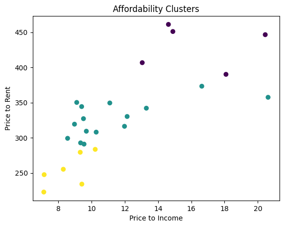
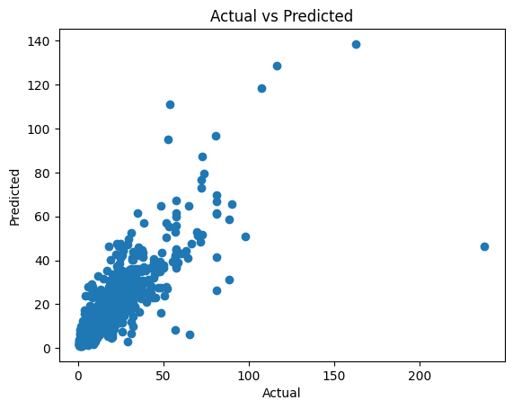
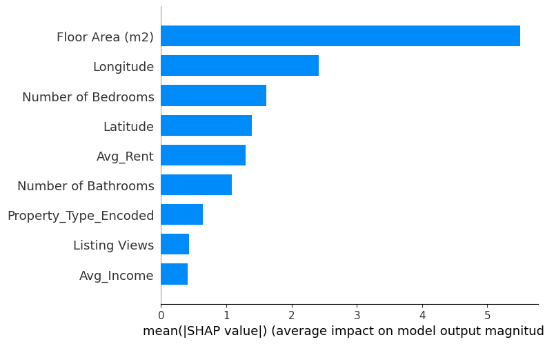
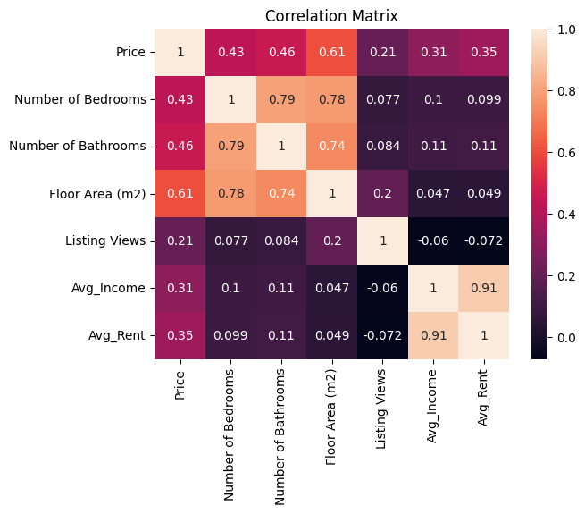
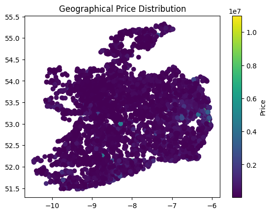

# Predicting and Visualising Housing Affordability in Ireland

MSc Data Analytics dissertation, Dublin Business School (May 2026).

This project uses machine learning and spatial analysis to find out what drives housing affordability across Ireland's 26 counties, and where affordability pressure is worst.

## Key results

- **XGBoost was the best model** for predicting the Price-to-Income ratio: R² = 0.705, RMSE = 7.38, MAE = 3.36 on the test set (mean R² = 0.722 across 10-fold cross-validation), against an R² of 0.479 for the Linear Regression baseline.
- **Dublin is the least affordable county**: a typical listing costs about 20.6 times average local income, against about 7.1 times in Roscommon.
- **Three affordability tiers**: K-Means clustering on Price-to-Income and Price-to-Rent ratios splits counties into high, moderate and lower pressure groups.
- **Floor area and location drive the predictions most**, according to SHAP.

## Data

The notebook is [`HousingAffordability_FINAL.ipynb`](HousingAffordability_FINAL.ipynb). The raw data files are not included in this repository (the Daft.ie listings contain full property addresses). To rerun it, place `daft_housing_data.csv`, `irish_rent_full.csv` and `disposable_income.csv` in the same folder; the notebook builds `FINAL_CLEAN_DATASET.csv` from them.

| Source | What it adds |
|---|---|
| Daft.ie property listings | Price, bedrooms, bathrooms, floor area, property type, coordinates (14,289 listings; about 10,461 after cleaning) |
| Residential Tenancies Board (RTB) | Average rent by county |
| Central Statistics Office (CSO) | Average disposable income by county |

The three sources were joined at county level. The property-level table was used for modelling; a 26-row county table was used for clustering, ranking and maps.

## Method

1. **Cleaning and integration**: removed incomplete records, standardised county names, and joined listings with RTB rent and CSO income.
2. **Feature engineering**: Price-to-Income and Price-to-Rent ratios; encoded property type; latitude and longitude kept as spatial features.
3. **Exploratory analysis**: distributions, a correlation heatmap and a geographic price map.
4. **Modelling**: Linear Regression (baseline), Random Forest, XGBoost and SVM (RBF kernel). XGBoost was tuned with RandomizedSearchCV and checked with 10-fold cross-validation.
5. **Clustering and ranking**: K-Means (k = 3) on the county table, and a county ranking by Price-to-Income ratio.
6. **Explainability**: SHAP values for the XGBoost model.

## Model comparison

| Model | MAE | RMSE | R² |
|---|---|---|---|
| Linear Regression | 5.196 | 9.807 | 0.479 |
| Random Forest | 3.288 | 7.505 | 0.695 |
| **XGBoost** | **3.363** | **7.381** | **0.705** |
| SVM | 3.678 | 8.721 | 0.588 |

## Visuals

**Affordability ranking by county (Price-to-Income ratio)**

**Affordability clusters**

**XGBoost: actual vs predicted**

**SHAP feature importance**

**Correlation heatmap**

**Geographic price distribution**

## Tools

Python (pandas, NumPy, scikit-learn, XGBoost, SHAP, matplotlib, seaborn), Jupyter, Power BI, Tableau.

## Limitations

- Listing prices are asking prices, not sale prices.
- Rent and income are county averages, so differences inside a county are hidden.
- The data is a snapshot in time, so the model does not capture market trends.

## Author

**Aadikrishna Unnikrishnan**, Data Analyst, Dublin  
[LinkedIn](https://www.linkedin.com/in/aadik1310) · aadikrishnaunnikrishnan@gmail.com
